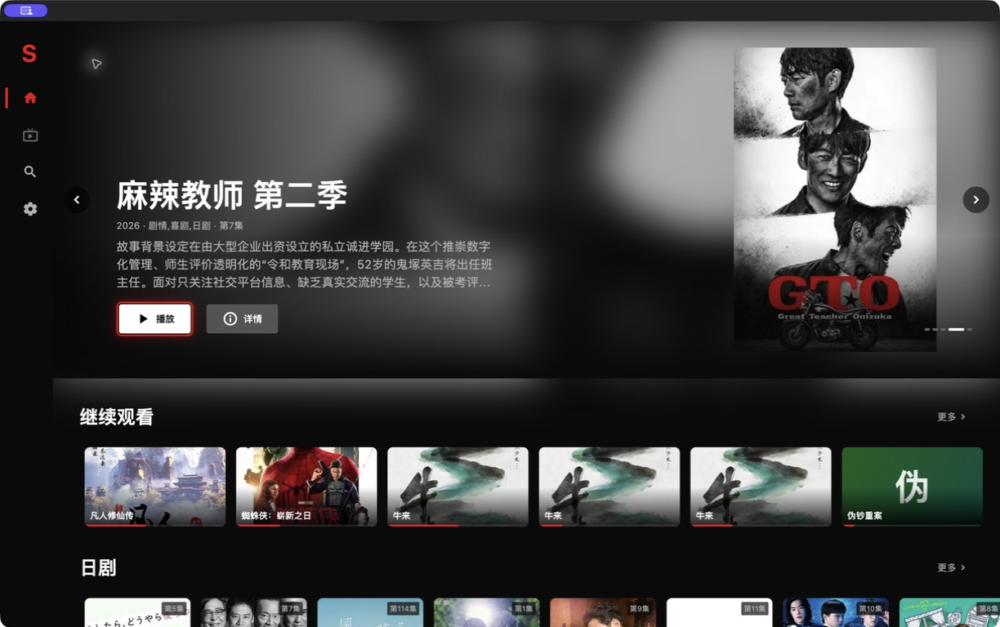
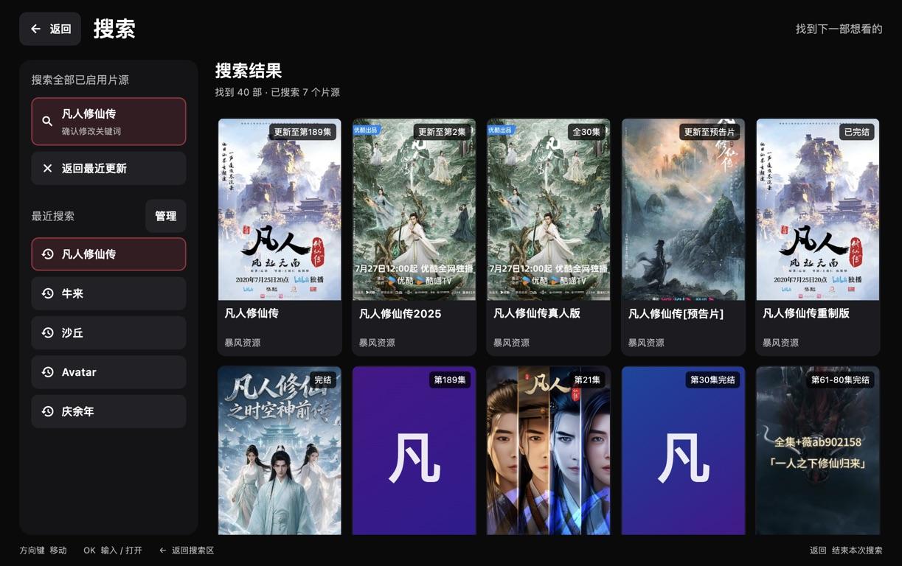
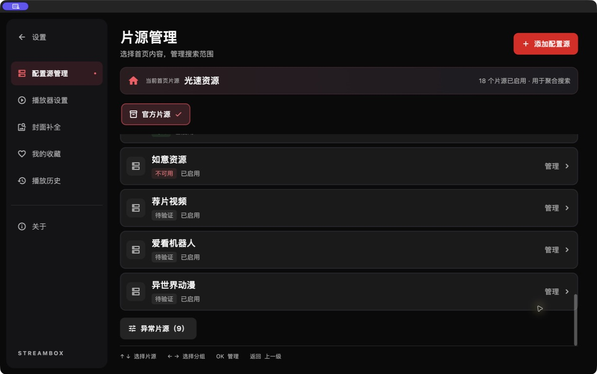
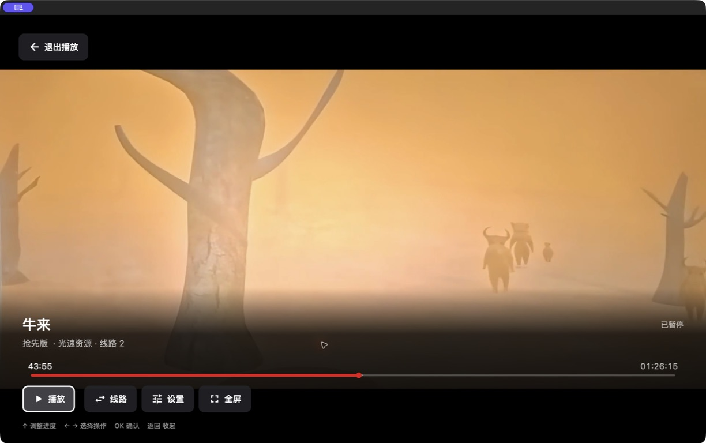
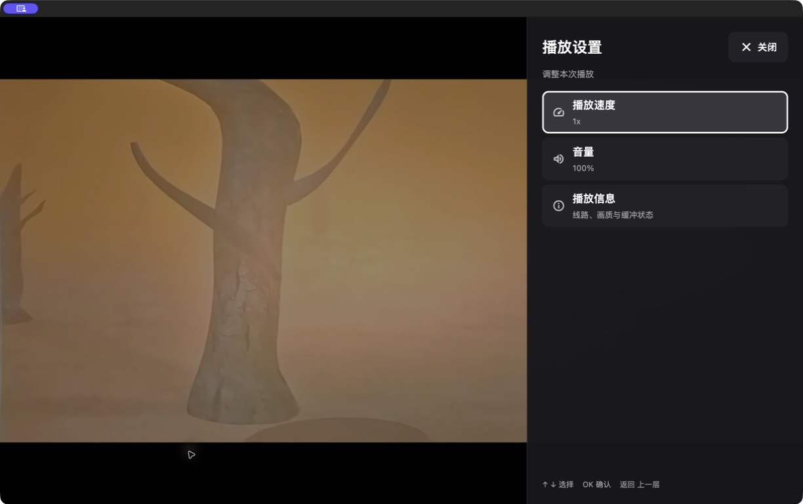

# StreamBox

Netflix 风格的跨平台流媒体播放器，对接 TVBox 生态片源。以电视、电视盒子和投影仪的遥控器操作为优先，同时适配桌面键鼠与手机触摸。全平台直接使用 CMS 接口；Android TV 和 Android 手机还可在本机运行 JAR/DEX Spider 插件，无需独立后端。

## 页面与交互

- **沉浸首页**：侧边导航、轮播推荐、继续观看和分类内容行；首页片源统一在设置中选择，顶部不再占用一整行。
- **聚合搜索**：宽屏采用左侧搜索与历史、右侧结果网格；加宽海报卡片，片名与来源分层显示，方向键移动时自动滚动并保留焦点。
- **遥控播放**：底部集中显示时间轴和常用操作，选集、线路与设置使用侧栏；左右键调整进度，松手自动跳转。
- **片源管理**：显示当前首页片源与搜索范围，按官方片源和自定义集合切换；确认片源行即可设置首页、启停片源或重新检测。健康检测最多 6 个片源同时进行，完成即补位，单源 12 秒超时；「等待检测」与「检测中」分别显示。

具体操作见 [客户端使用方法与遥控器指南](client/README.md#使用方法)。

## 预览

以下为 2026-09-03 在 macOS 运行当前版本截取的真实页面。截图展示宽屏布局；TV 遥控器与系统输入法仍需实机验收。



| 搜索：加宽卡片、搜索历史与来源信息 | 设置：片源分组、首页选择与搜索范围 |
| --- | --- |
|  |  |
| 播放：时间轴与常用操作集中在底部 | 播放侧栏：倍速、音量与播放信息 |
|  |  |

点击图片可查看大图。[截图说明](client/assets/screenshots/README.md)。

### 早期版本演示视频

<video src="https://github.com/huangj17/StreamBox-APP/raw/main/client/assets/StreamBox.mp4" controls width="720"></video>

> 视频保留早期版本的操作演示，当前界面以上方截图为准。如未在 GitHub 网页内联播放，可点击 [此处下载查看](client/assets/StreamBox.mp4)。

## 仓库结构

| 目录          | 说明                                  | 技术栈                              | README                                       |
| ------------- | ------------------------------------- | ----------------------------------- | -------------------------------------------- |
| `client/`     | Flutter 客户端（主应用）              | Flutter/Dart + Riverpod + media_kit | [client/README.md](client/README.md)         |
| `client/android/` | Android 本机 Spider 宿主 | Kotlin + Android DEX / JNI | [原生宿主说明](client/android/README.md) |

## 片源架构

```text
全平台 StreamBox ──HTTPS──> CMS 接口 ──> 播放器
Android StreamBox ──原生通道──> 本机 Spider 进程 ──> 播放器
```

CMS 可在所有平台显示和使用。`csp_` JAR 站点只在 Android 上显示，插件按需下载、校验与加载。
其他平台导入混合 TVBox 配置后仅显示其中的 CMS 站点。JS/Python 运行时尚未接入。
Android 插件媒体代理只监听本机，目录、搜索和解析不经过外部服务器。

## 快速开始

```bash
./dev.sh                         # 启动 macOS 客户端
DEVICE=<Android设备ID> ./dev.sh   # 启动 Android 客户端
./dev.sh test                    # 静态检查与 Flutter 测试
./dev.sh test-android            # Android 原生单元测试
./dev.sh build apk --debug --target-platform android-arm64
```

也可在 `client/` 中执行 `flutter pub get` 和 `flutter run -d <设备ID>`。
Android JAR 配置、兼容范围及验收步骤见 [原生宿主说明](client/android/README.md)。

### 官方片源远程配置（免重新安装）

安装支持远程配置的客户端后，只需维护服务器上的一个 JSON 文件，即可更新官方片源的地址、顺序和上下架状态。启动时后台同步，前台每 30 分钟检查，也可在「设置 → 配置源管理 → 官方片源」选择「立即更新」；网络失败时继续使用缓存，用户自定义源不被清理。

客户端不再内置暴风、红牛两个兜底源；首次未同步成功且没有缓存时，官方列表为空，需联网同步或添加自定义源。

片源页只展示简短同步状态；版本、地址、检查频率和完整错误可从「详情」查看。启动时会一次性移除已被官方缓存覆盖的重复 OuonnkiTV Lite 订阅，保留原地址、缓存及片源偏好，仍可手动重新添加恢复；含独有片源的订阅不受影响。

默认地址：[官方片源配置](http://1.14.171.39/streambox/sources.json)。支持 `id/name/url/isEnabled` 数组，无需手动填写版本号，并兼容旧对象格式。升级会将先前的 HTTPS 官方订阅迁移回此 IP，保留缓存和自定义源。当前入口使用 HTTP 明文传输，存在被篡改风险；仅固定官方配置入口保留 HTTP 兼容；CMS 和自定义订阅的地址限制保持不变。完整官方列表：[deploy/streambox/sources.json](deploy/streambox/sources.json)。上传路径、字段说明、发布校验、回滚和安全边界见 [远程配置部署指南](deploy/streambox/README.md)。

### 旧 Bridge 迁移

独立 JVM Bridge 已移除，官方列表不再包含其三个远程接口。客户端升级时过滤旧接口和缓存的
Gateway 元数据，清理已保存的 Bridge 订阅。CMS、自定义 TVBox 配置以及历史/收藏记录保留；
原 Bridge 的历史记录不会自动映射到另一份插件，需要导入相应 Android TVBox 配置后重新选源。
只有 JAR 站点的配置在非 Android 设备上显示为空，混合配置中的 CMS 仍然可用。

## 环境要求

Flutter / Dart 按 `client/pubspec.yaml` 的 SDK 约束安装。Android 构建需要 Android SDK 和 JDK 17+；
macOS 构建需要 Xcode / CocoaPods。Android 本机插件无需安装或启动独立服务器。

## 更新日志

各版本变更见 [CHANGELOG.md](CHANGELOG.md)，发布产物见 [Releases](https://github.com/huangj17/StreamBox-APP/releases)。

## 贡献

欢迎 Issue 和 PR。提交前请阅读 [CONTRIBUTING.md](CONTRIBUTING.md)：

- Bug / 功能建议走 [Issues](https://github.com/huangj17/StreamBox-APP/issues)，使用对应模板
- 较大改动先开 Issue 讨论再写代码
- `main` 分支受保护，所有改动须通过 PR + 1 个 approval

## 许可证

[MIT License](LICENSE)。本项目仅作技术研究与学习用途，使用者需自行确保所接入的内容源合法合规，与本项目作者无关。
